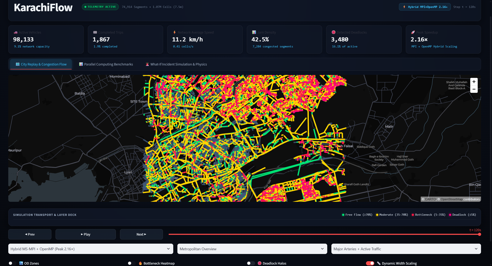
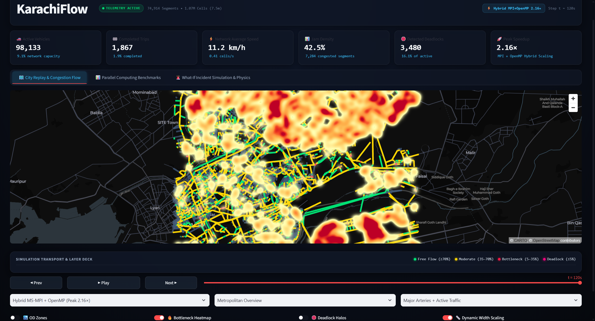
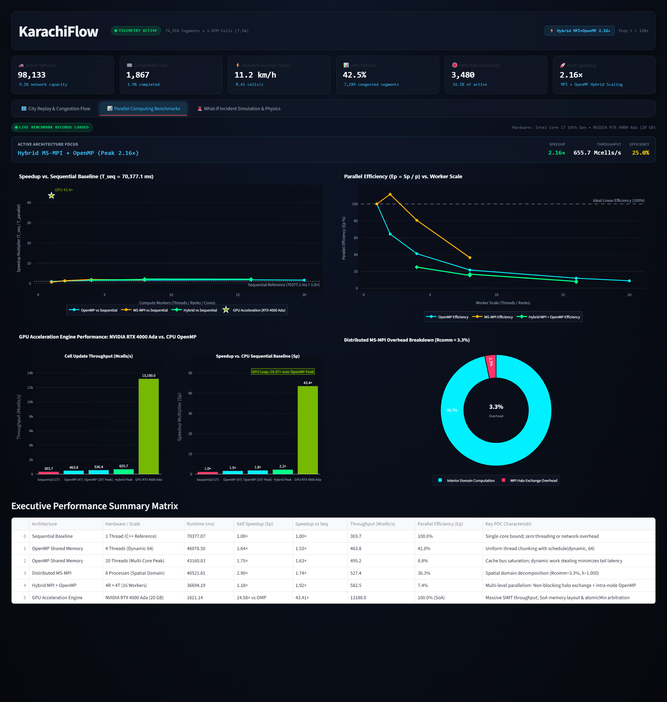
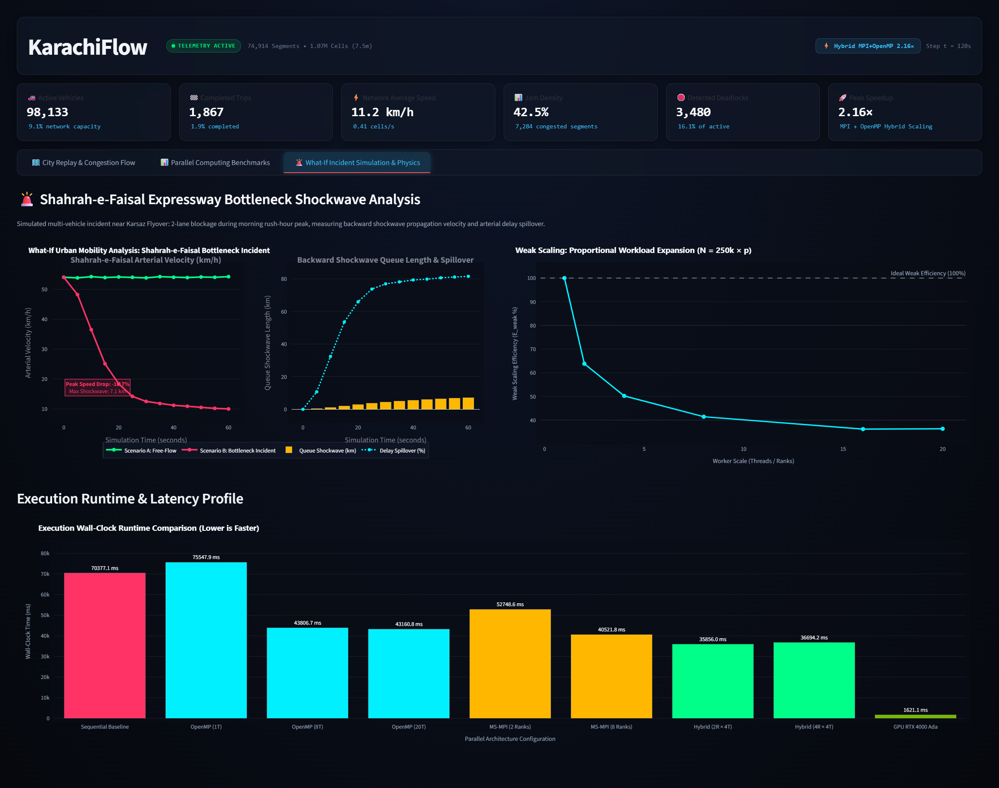
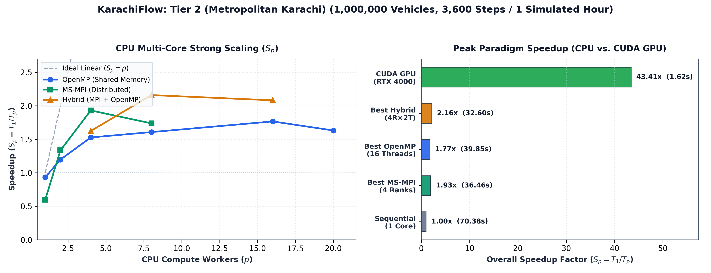
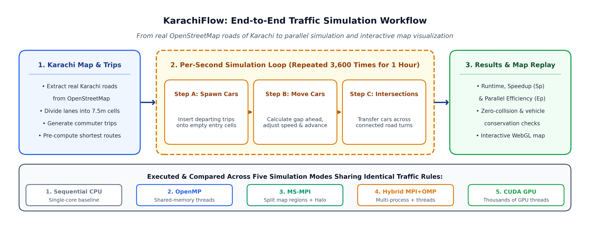

<div align="center">

# KarachiFlow

### City-Scale Microscopic Traffic & Congestion Simulator

A high-performance traffic simulator built on the real OpenStreetMap road network of Karachi. Simulate millions of individual vehicles across 7.5-meter road cells, compare **Sequential**, **OpenMP**, **MS-MPI**, **Hybrid (MPI + OpenMP)**, and **CUDA GPU** execution, and explore rush-hour bottlenecks in an interactive WebGL map dashboard.

[Overview](#overview) · [Preview](#preview) · [Features](#features) · [Parallel Approaches](#parallel-approaches) · [Benchmarks](#benchmarks) · [Architecture](#architecture) · [Setup](#setup) · [Testing](#testing)

</div>

---

## Overview

KarachiFlow models urban traffic at the individual vehicle level across real Karachi corridors such as Shahrah-e-Faisal, M.A. Jinnah Road, University Road, and Saddar. Every road lane is divided into 7.5-meter cells and updated every simulated second using the four-step Nagel-Schreckenberg cellular automaton model (speed up, brake for the gap ahead, random human slowdown, and move forward).

Because updating millions of cars over an entire hour requires tens of billions of cell updates, KarachiFlow implements five parallel execution engines sharing the exact same traffic rules. Simulation runs can export lightweight state snapshots for offline playback and bottleneck analysis in a Streamlit and PyDeck dashboard.

---

## Preview

<div align="center">

### City Traffic Replay Dashboard



<sub>The main dashboard replays rush-hour traffic across 74,914 road segments with live KPI cards, congestion color coding, and timeline controls.</sub>

<br/><br/>

### Bottleneck Heatmap & Commuter Zones



<sub>Spatial heatmap and origin-destination zone overlays highlight congestion hotspots across Saddar, Karsaz, and Gulshan.</sub>

<br/><br/>

### Parallel Speedup & Efficiency Analytics



<sub>Interactive scaling charts compare speedup, parallel efficiency, GPU acceleration, and MPI communication overhead across worker counts.</sub>

<br/><br/>

### What-If Incident & Weak Scaling Analysis



<sub>Counterfactual scenario analysis evaluates the impact of a peak-hour bottleneck on Shahrah-e-Faisal alongside weak scaling efficiency.</sub>

</div>

---

## Features

- Extract and discretize real Karachi road networks from OpenStreetMap into fast binary files (`7.5m` cell resolution).
- Simulate 500,000 to 10,000,000 vehicles across three geographic tiers (Urban Core, Metropolitan Karachi, and Regional Mega-Corridor).
- Compare Sequential, OpenMP, MS-MPI, Hybrid (MPI + OpenMP), and CUDA GPU execution on the same traffic workload.
- Guarantee 100% bit-exact repeatability between single-core and multi-thread runs using double-buffered grids and stateless hashing.
- Evaluate OpenMP loop scheduling policies (`static`, `dynamic`, and `guided`) and MPI load balance across processes.
- Replay simulation snapshots at sub-100ms frame scrubbing speeds in an interactive PyDeck WebGL map.
- Run counterfactual "What-If" incident simulations to measure speed drops and queue spillback on major arteries.

---

## Parallel Approaches

| Approach | How it works | Key Strength |
| --- | --- | --- |
| **Sequential Baseline** | Updates all road segments and intersections on a single CPU core using flat contiguous arrays. | Serves as the exact $T_1$ reference for speedup and correctness checks. |
| **OpenMP (Shared Memory)** | Splits road segments across CPU threads with 64-byte padded private counters and configurable loop schedules. | Low overhead on compact maps and 100% bit-exact trajectory match. |
| **MS-MPI (Distributed Memory)** | Partitions the city map into geographic regions and overlaps interior road updates with non-blocking `MPI_Isend` / `MPI_Irecv` boundary transfers. | Scales across separate processes with zero vehicle loss across borders. |
| **Hybrid (MPI + OpenMP)** | Combines coarse-grained MPI map regions with multi-threaded OpenMP teams inside each process. | Reaches the highest CPU speedup (**2.16x**) by improving cache locality and reducing MPI message traffic. |
| **CUDA GPU** | Stores vehicle state in Structure-of-Arrays (SoA) device memory, spawns trips directly on the GPU, and resolves intersection turns via `atomicMin`. | Delivers up to **43.41x** speedup (**13.19 billion** cell updates/sec) by streaming across GPU memory bandwidth. |

---

## Benchmarks

All benchmarks below were executed for a full **1-hour simulated horizon (3,600 steps)** with snapshot disk I/O disabled (`--snapshot-interval 0`):

| Geographic Tier | Network Scale | Vehicle Workload | Sequential CPU ($T_1$) | Best Parallel CPU | CUDA GPU Runtime | Peak GPU Speedup |
| --- | --- | --- | --- | --- | --- | --- |
| **Tier 1: Urban Core** | 74,914 segments / 1.07M cells | 500,000 cars | 7.57 s | 5.79 s (**1.31x** @ OMP 8T) | **0.93 s** | **8.18x** |
| **Tier 2: Metro Karachi** | 471,337 segments / 5.94M cells | 1,000,000 cars | 70.38 s | 32.60 s (**2.16x** @ Hybrid 4R×2T) | **1.62 s** | **43.41x** |
| **Tier 3: Regional Mega** | 568,542 segments / 9.10M cells | 2,000,000 cars | 59.48 s | 39.18 s (**1.52x** @ OMP 16T) | **4.46 s** | **13.35x** |
| **Tier 3: Pre-Seeded Load** | 568,542 segments / 9.10M cells | 10,000,000 cars | 34.37 s | 22.61 s (**1.52x** @ OMP 16T) | **1.25 s** | **27.43x** |

<br/>

<div align="center">



<sub>3,600-step scaling on Tier 2 Metropolitan Karachi (1,000,000 vehicles): Hybrid MPI + OpenMP reaches 2.16x on CPU (left), while GPU-resident CUDA execution reaches 43.41x speedup (right).</sub>

</div>

---

## Architecture

<div align="center">



<sub>End-to-end workflow separating offline OpenStreetMap graph preparation, the per-second C++/CUDA simulation loop, and interactive WebGL replay.</sub>

</div>

### Tech Stack

| Layer | Technology |
| --- | --- |
| **Simulation Core** | C++17, CMake |
| **CPU Parallelism** | OpenMP (Shared Memory), Microsoft MPI / OpenMPI (Distributed & Hybrid) |
| **GPU Acceleration** | NVIDIA CUDA (`sm_89`, Structure-of-Arrays, Lock-Free Atomics) |
| **GIS & Dashboard** | Python, OSMnx, NetworkX, Streamlit, PyDeck (WebGL), Plotly, Matplotlib |

### Project Structure

```text
src/engine/       Core NaSch traffic rules, vehicle structures, binary road loader, and trip demand
src/parallel/     OpenMP, MS-MPI, Hybrid (MPI + OpenMP), and CUDA GPU simulation engines
src/main.cpp      Unified CLI entrypoint, timer harness, and benchmark runner
scripts/          OSMnx map preprocessor, Streamlit/PyDeck dashboard, and benchmark suites
data/benchmarks/  Empirical 3,600-step CSV timings, JSON summaries, and scaling plots
docs/             Project report (.pdf), proposal (.pdf), and dashboard screenshots
```

---

## Setup

### Prerequisites

- **C++ Compiler:** C++17 compiler (MSVC 2022, GCC 14+, or Clang) and CMake 3.20+
- **Python:** Python 3.10+
- *(Optional)* **MPI:** Microsoft MPI (MS-MPI v10+) or OpenMPI
- *(Optional)* **GPU:** NVIDIA CUDA Toolkit 12+

### 1. Clone and set up Python

```bash
git clone https://github.com/AbdulRafayMughal86/KarachiFlow.git
cd KarachiFlow

python -m venv .venv
# Windows PowerShell:
.\.venv\Scripts\Activate.ps1
# Linux / macOS:
source .venv/bin/activate

pip install -r requirements.txt
```

### 2. Generate the Karachi road network binary

Large binary road maps are excluded from Git. Before running the C++ simulator on a fresh clone, generate the binary network file once:

```bash
# Urban Core map (Tier 1, downloads from OpenStreetMap and builds data/karachi_network.bin)
python scripts/preprocess_graph.py --mode dev

# Offline fallback (no internet required, builds a synthetic Karachi test grid)
python scripts/preprocess_graph.py --mode synthetic
```

Use `--mode full` for Metropolitan Karachi (Tier 2) or `--mode regional` for the Regional Mega-Corridor (Tier 3).

### 3. Build the C++ binaries

```bash
cmake -B build -S . -DCMAKE_BUILD_TYPE=Release
cmake --build build --config Release
```

Compiled binaries are placed in `bin/` (or `bin/Release/` on Windows MSVC multi-config builds).

### 4. Run the simulator

```bash
# Quick developer run (5,000 vehicles, 60 steps, finishes in < 1 second)
./bin/karachiflow --dev

# OpenMP shared-memory run across 8 threads
./bin/karachiflow --threads 8 --cars 50000 --steps 60

# OpenMP with guided loop scheduling
./bin/karachiflow --threads 8 --schedule guided 64 --cars 50000 --steps 60

# Distributed MS-MPI run across 4 processes
mpiexec -n 4 ./bin/karachiflow --mpi --cars 50000 --steps 60

# Hybrid MPI + OpenMP run (4 MPI ranks x 2 OpenMP threads)
mpiexec -n 4 ./bin/karachiflow --hybrid --threads 2 --cars 50000 --steps 60

# CUDA GPU execution (uses GPU when built with CUDA, otherwise CPU SoA fallback)
./bin/karachiflow --cuda --cars 500000 --steps 3600 --snapshot-interval 0
```

### 5. Launch the interactive dashboard

```bash
streamlit run scripts/dashboard.py
```

Open `http://localhost:8501` in your browser to inspect the Karachi traffic replay, bottleneck heatmaps, and scaling charts.

---

## Testing

Run the automated C++, CUDA, and Python verification suite:

```bash
# 1. Binary road graph loader verification
./bin/test_network_reader

# 2. NaSch fundamental diagram and traffic physics check
./bin/test_nasch_validation

# 3. OpenMP bit-exact determinism across 1, 2, 4, and 8 threads
./bin/test_openmp_scaling

# 4. MS-MPI boundary handover and zero vehicle loss check
mpiexec -n 4 ./bin/test_mpi_simulation

# 5. Hybrid MPI + OpenMP verification
mpiexec -n 2 ./bin/test_hybrid_simulation

# 6. CUDA GPU zero-collision and conservation check (50,000 vehicles)
./bin/test_cuda_simulation 50000

# 7. Python unit test suite
python -m unittest discover tests
```

---

## Credits

Built by <a href="https://github.com/AbdulRafayMughal86"><strong>Abdul Rafay Mughal</strong></a>, <a href="https://github.com/abubakar-ahmed-dev"><strong>Abubakar Ahmed</strong></a>, and <a href="https://github.com/awaisbegin014"><strong>Muhammad Awais</strong></a>.

<br/>

---

<div align="center">

### Thanks for checking this out! 👋

*"Simulating a full hour of Karachi traffic in 1.62 seconds is easy; surviving Shahrah-e-Faisal at 9 AM is the real benchmark."* 🚗

</div>
